\<!--   README DE MI PERFIL DE GITHUB (repositorio raulo9/raulo9)   Este archivo es lo que se ve en la portada de mi perfil de GitHub.   Los comentarios como este no se ven en GitHub, solo en el código.   Casi todo son imágenes SVG que hice yo (están en la carpeta "assets")   para que mi perfil tenga el mismo aspecto de terminal que mi portfolio. -->

\<!-- Todo va dentro de este div con align="center" para que quede centrado en la página -->

\<div align="center">

\<!-- Cabecera: ventana de terminal con mi nombre -->

\

\<br>

\<!-- Franja con los comandos que se van escribiendo solos -->

\

\<br>\<br>

\<!-- Ventana "whoami / sobre_mi.txt": quién soy y a qué me dedico -->

\

\<br>

\<!-- Ventana "ls -l \~/tecnologias": las tecnologías que manejo -->

\

\<br>

\<!-- Tarjetas de mis proyectos: tabla para mantener las tres imágenes alineadas -->

\<table align="center" width="100%">   \<tr>     \<td align="center" width="33.33%" valign="top">       \<!-- Tarjeta 1: Catálogo de Videojuegos -->       \<a href="[https://raulo9.github.io/Cat-logo-de-Videojuegos/](https://raulo9.github.io/Cat-logo-de-Videojuegos/)">         \       \</a>     \</td>

```
<td align="center" width="33.33%" valign="top">
  <!-- Tarjeta 2: Galería de GTA V -->
  <a href="https://raulo9.github.io/GTA-V-/galeria.html">
    
  </a>
</td>

<td align="center" width="33.33%" valign="top">
  <!-- Tarjeta 3: Web animada de GTA VI -->
  <a href="https://raulo9.github.io/GTA-VI/">
    
  </a>
</td>
```

&#x20; \</tr> \</table>

\<br>

\<!-- Botones de contacto: tabla para mantener las tres tarjetas alineadas -->

\<table align="center" width="100%">   \<tr>     \<td align="center" width="33.33%" valign="top">       \<!-- LinkedIn -->       \<a href="[https://www.linkedin.com/in/raul-oliva-garc%C3%ADa](https://www.linkedin.com/in/raul-oliva-garc%C3%ADa)">         \       \</a>     \</td>

```
<td align="center" width="33.33%" valign="top">
  <!-- Email: mailto abre el programa de correo -->
  <a href="mailto:rauloliva2001@gmail.com">
    
  </a>
</td>

<td align="center" width="33.33%" valign="top">
  <!-- Portfolio -->
  <a href="https://raulo9.github.io">
    
  </a>
</td>
```

&#x20; \</tr> \</table>

\<br>

\<!-- Pie de la página: última línea de la terminal -->

\

\<!-- Aquí cierro el div que mantiene todo centrado -->

\</div>
