<!--
  README DE MI PERFIL DE GITHUB (repositorio raulo9/raulo9)
  Este archivo es lo que se ve en la portada de mi perfil de GitHub.
  Los comentarios como este no se ven en GitHub, solo en el código.
  Casi todo son imágenes SVG que hice yo (están en la carpeta "assets")
  para que mi perfil tenga el mismo aspecto de terminal que mi portfolio.
-->

<!-- Todo va dentro de este div con align="center" para que quede centrado en la página -->

<!-- Cabecera: ventana de terminal con mi nombre (assets/cabecera.svg). El width="840" es el ancho máximo y el alt es el texto que se lee si la imagen no carga -->

<!--   es un salto de línea: deja un poco de espacio entre imágenes -->
 

<!-- Franja con los comandos que se van escribiendo solos (animación del archivo escribiendo.svg) -->

<!-- Dos saltos de línea para separar más la cabecera del resto -->
  

<!-- Ventana "whoami / sobre_mi.txt": quién soy y a qué me dedico -->

 

<!-- Ventana "ls -l ~/tecnologias": las tecnologías que manejo, con el color de cada lenguaje -->

 

<!-- Tarjetas de mis proyectos. Cada imagen va dentro de un enlace <a>, así que al pulsar la tarjeta se abre el proyecto. Miden 272px para que quepan tres en una fila -->
<!-- Tarjeta 1: enlaza con el Catálogo de Videojuegos publicado en GitHub Pages -->

<!-- Tarjeta 2: enlaza con la galería de mi web adaptable de GTA V -->

<!-- Tarjeta 3: enlaza con la web animada de GTA VI publicada en GitHub Pages -->

 

<!-- Botones de contacto. Cada uno es una imagen dentro de un enlace -->
<!-- LinkedIn: abre mi perfil (la í de "garcía" va escrita como %C3%AD porque las direcciones web no admiten tildes directamente) -->

<!-- Email: "mailto:" abre el programa de correo con mi dirección ya escrita -->

<!-- Portfolio: abre mi web personal en GitHub Pages -->

 

<!-- Pie de la página: la última línea de la terminal (assets/pie.svg) -->

<!-- Aquí cierro el div que lo mantiene todo centrado -->

